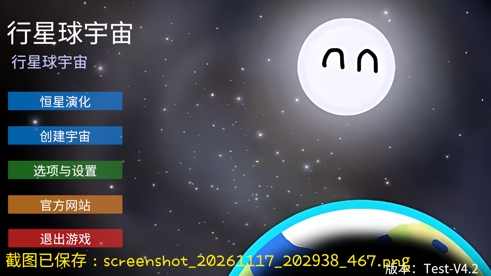
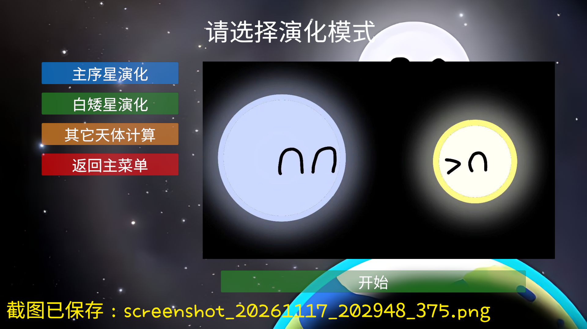
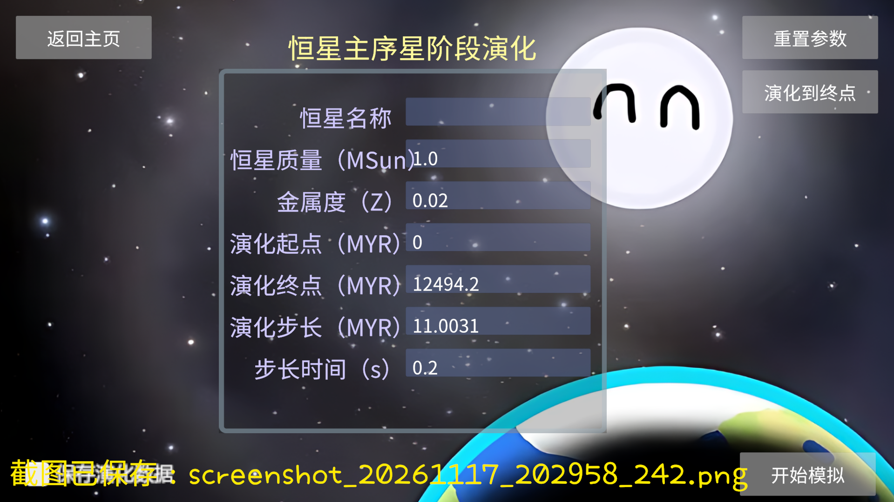
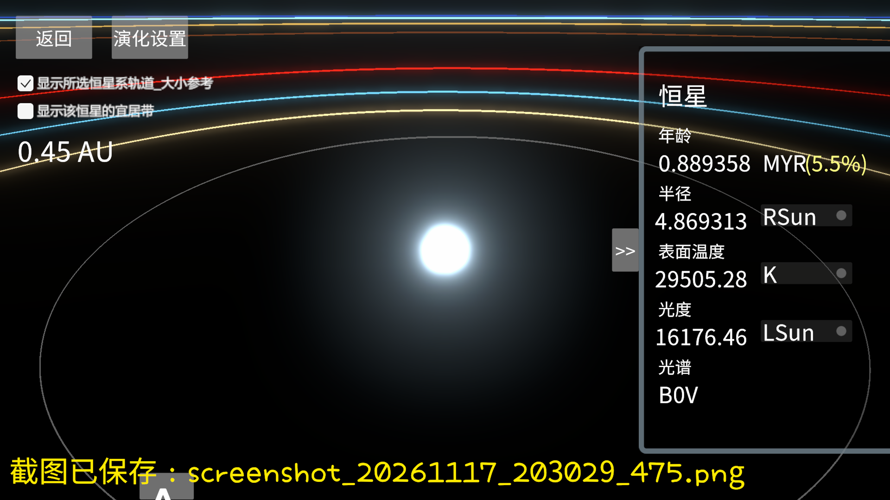
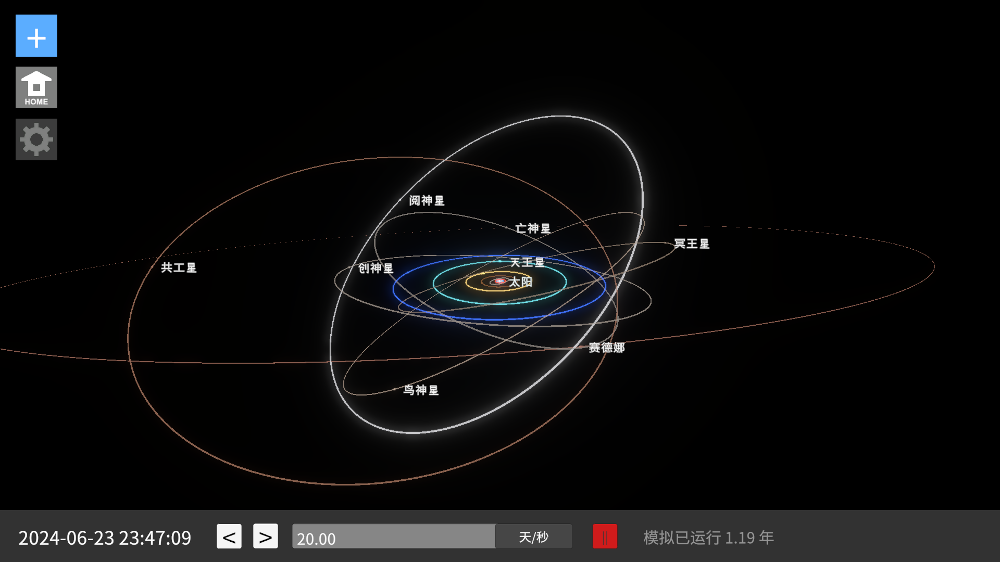
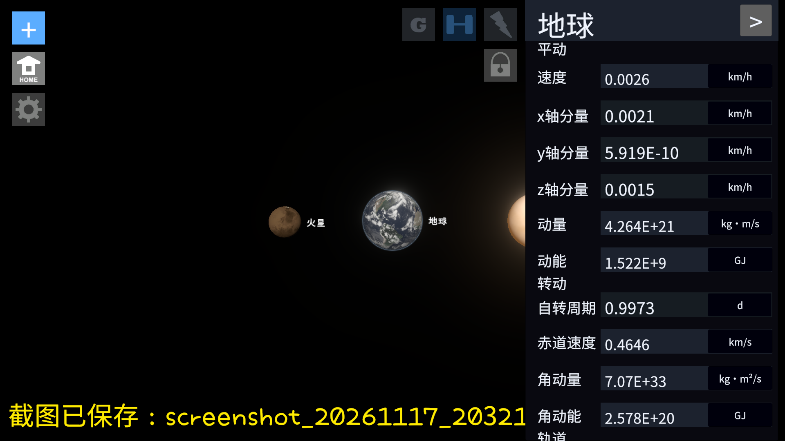
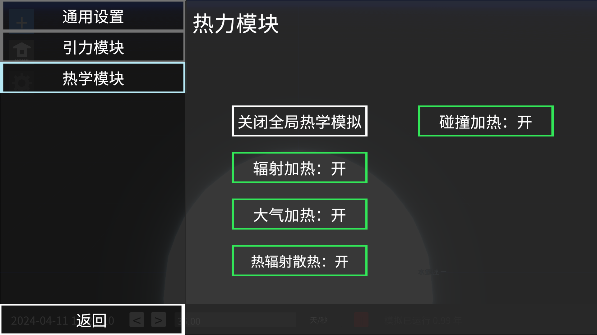
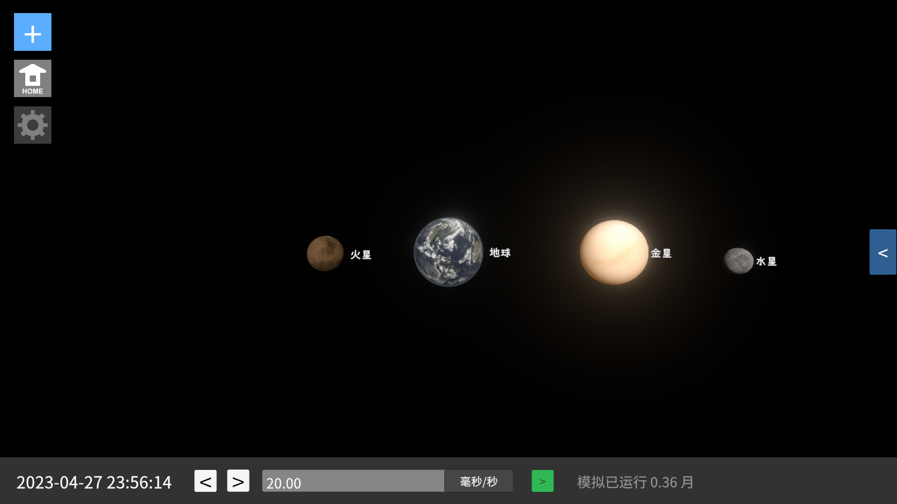

# 行星球宇宙 · UPB-3D

行星球宇宙的 3D 版本。原项目在 Python 端遇到瓶颈后整体迁到 Unity，把模拟场景升级成可以自由观察的 3D 宇宙；迁移始于 2026 年 4 月 11 日。

| 项目 | 说明 |
| --- | --- |
| 引擎 | Unity 2022.3.62f3c1（URP） |
| 平台 | Windows PC |
| 当前版本 | Test-V4.2 |
| 官网 | <https://upb.m82.org> |



## 一、主菜单

四个入口：**恒星演化**、**创建宇宙**、**选项与设置**、**官方网站**。界面支持中 / 英双语。

## 二、恒星演化



分三种计算模式：

- **主序星演化**：按初始质量与金属丰度，逐步演算恒星从主序到末期的完整一生；
- **白矮星演化**：从 10^7 年起做冷却演化，质量上限取钱德拉塞卡极限 1.44 M☉；
- **其它天体计算**：输入天体类型与质量，直接算出半径、表面温度、光度与光谱型。



参数页填恒星名称、质量（M☉）、金属度（Z）、演化起点 / 终点（Myr）、步长（Myr）与步长时间（秒）。
终点和步长会按当前质量、金属度自动给出寿命与推荐步长，也可以「重置参数」或一键「演化到终点」；
勾选后会把每一步的演化数据导出到工程目录 `simulations/` 下的文本里。



演化画面右侧实时显示年龄、半径、表面温度、光度与光谱型（图中为 14 M☉ 主序星），
半径 / 温度 / 光度都可切换单位；可叠加恒星系轨道参考线和宜居带，`空格` 暂停，`H` 宜居带，`O` 行星轨道。

## 三、创建宇宙

自由沙盒：随意放置恒星与行星，实时跑轨道与物理，随时存档。



自带若干代表性存档（太阳系、水瓶座一系、心大星行星系……）。底部时间条显示宇宙日期与
模拟已运行时间，可暂停、可调倍速（从毫秒/秒到天/秒）。



选中天体后展示平动 / 转动 / 轨道的实时物理量：速度及其分量、动量、动能、自转周期、
赤道速度、角动量、角动能等，单位随量级切换（km/h、kJ、d、kg·m/s……）。



物理过程拆成可单独开关的模块——通用设置、引力模块、热学模块（碰撞加热、辐射加热、
大气加热、热辐射散射），方便对照「开 / 关」前后的结果。


存档系统：新建存档、保存场景，列表带缩略图。存档是 JSON 格式的 `.upbsav`，
放在 `%USERPROFILE%\AppData\LocalLow\planetballphysics\行星球宇宙Test\UPBSaves`，
可以直接用文本编辑器修改或备份。



天体数据取自真实资料：`Assets/Resources/Data` 下的 Planets、Moons、DwarfPlanets&Asteroids、
Stars 等 JSON 给出半径、大气、轨道参数，配真实行星贴图与 URP 光照（图中为水星、金星、地球、火星）。

## 操作速查

| 按键 | 作用 |
| --- | --- |
| 左键拖动 / 滚轮 / `WASD` | 旋转视角 / 缩放 / 平移 |
| `空格` | 暂停 / 继续 |
| `←` `→` | 时间倍速减 / 加 |
| `G` `T` `O` `L` `F3` | 网格 / 轨迹 / 轨道 / 标签 / 统计面板 |
| `H` | 宜居带（恒星演化场景） |
| `F2` | 截图，保存到游戏目录的 `screenshots/` |
| `F4` / `F9` | 重开教学 / 沙盒引导 |

## 目录与构建

```
Assets/
├─ Scenes/       场景（MainMenu、EvolutionChoose、SandboxScene……）
├─ Scripts/      逻辑与模拟（SSE 恒星演化、沙盒物理、存档、UI）
├─ Resources/    数据表、贴图、音乐、字体
└─ Shaders/      轨道线、恒星、行星等着色器
docs/screenshots/ 本文配图
```

用 Unity 2022.3.62f3c1 打开本工程，载入 `Assets/Scenes/MainMenu.unity`，
在 Build Settings 里选 Windows 平台即可构建。

## 许可证

MIT，详见 [LICENSE](LICENSE)。© 2026 happyFRC
