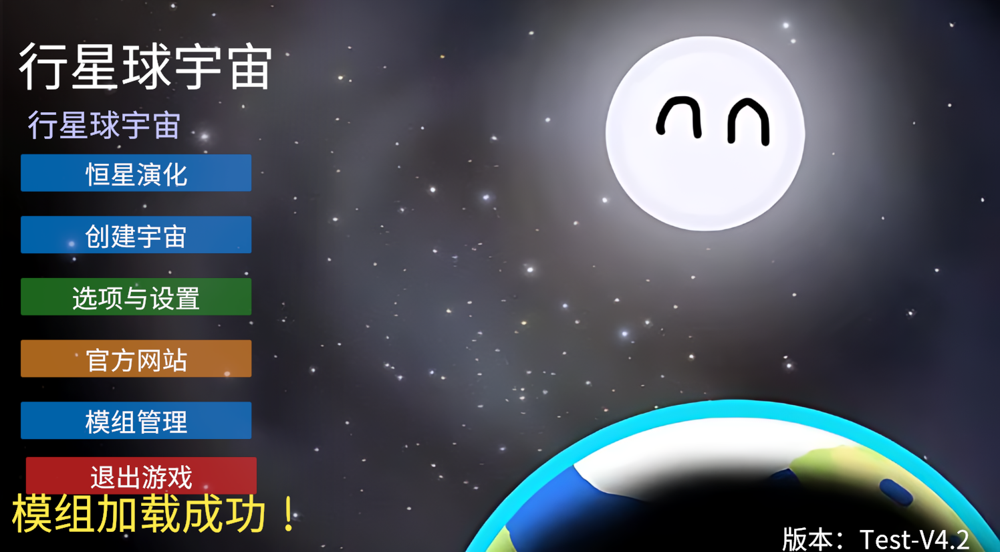
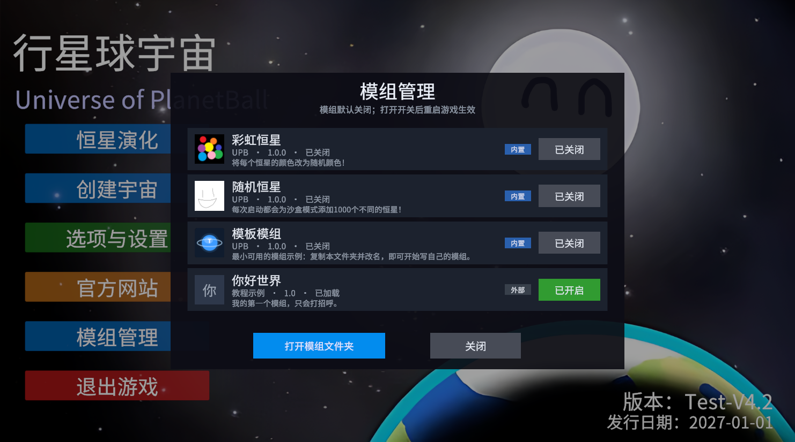

# 02 · 准备工作

这一篇不需要写代码，只需要把"东西在哪"搞清楚。后面每一步都会用到。

## 1. 找到游戏根目录

"游戏根目录"就是**游戏 exe 所在的那个文件夹**。

- 如果你是从压缩包解压玩的：解压出来的那个文件夹就是根目录；
- 如果你不确定：在桌面上找到游戏的快捷方式 → 右键 → "打开文件所在的位置"，资源管理器打开的就是根目录。

根目录里应该能看到这些东西（名字可能略有不同）：

```
Universe of PlanetBall.exe      ← 游戏本体
Universe of PlanetBall_Data\    ← 游戏数据
Logs\                           ← 日志（运行过游戏后才有）
Mods\                           ← 模组目录（运行过游戏后会自动创建）
```



## 2. 找到（或创建）Mods 文件夹

`Mods` 文件夹和 exe 在同一个目录下。

- 如果你运行过游戏，它应该已经自动创建了；
- 如果没有，手动新建一个，名字就叫 `Mods`（注意大小写，建议完全一致）。

每个模组是 `Mods` 里的一个**子文件夹**，比如 `Mods\HelloWorld\`。

> 小技巧：现在先不用手动去找。打开游戏 → 主菜单 → 左侧「模组管理」→ 底部的「打开模组文件夹」按钮，会直接帮你打开这个目录。



## 3. 认识"模组管理"面板

主菜单左侧有一个「模组管理」按钮，点开后会列出所有模组，每个模组一行，能看到：

- 名字、作者、版本、说明；
- 右边有一个开关：`已关闭` / `已开启`；
- 右上角有 `内置` 或 `外部` 标签（玩家自己放进去的是"外部"）。

**所有模组默认关闭。** 你要先把它打开成"已开启"，然后**完全退出游戏再重新打开**，模组才会真正加载。

面板最下面还有「打开模组文件夹」按钮，和「关闭」按钮。

## 4. 准备一个文本编辑器

`.cs` 文件是纯文本，任何文本编辑器都能打开。推荐：

- **VS Code**（免费，有代码高亮，最推荐）；
- **Notepad++**（轻量）；
- 系统自带的**记事本**也能用。

用记事本时注意两点：

1. 保存时"编码"选 **UTF-8**（否则中文可能乱码）；
2. 保存类型选"所有文件"，文件名自己写全 `HelloWorld.cs`，**不要**让它变成 `HelloWorld.cs.txt`。

建议先在资源管理器里打开"文件扩展名"显示：

- Windows 11：资源管理器 → 查看 → 显示 → 文件扩展名；
- Windows 10：资源管理器 → 查看 → 勾选"文件扩展名"。

这样你能一眼看出文件是不是真的叫 `.cs`。

## 5. 认识日志文件

游戏每次运行都会在根目录的 `Logs` 文件夹里生成一个日志文件，名字像：

```
Logs\log-20261128-183000.txt
```

日志里记录了游戏运行时发生的事，包括你的模组加载成功/失败的信息。**排查问题主要靠它**，后面会专门讲怎么读。

## 检查清单

动手前确认：

- [ ] 知道游戏根目录在哪；
- [ ] 能看到（或能新建）`Mods` 文件夹；
- [ ] 会打开「模组管理」面板；
- [ ] 有一个能保存 UTF-8 的文本编辑器；
- [ ] 能看到 `Logs` 文件夹。

都准备好了，下一篇我们做第一个模组。

此文档由AI生成仅供参考，如有问题请在QQ群内提问
