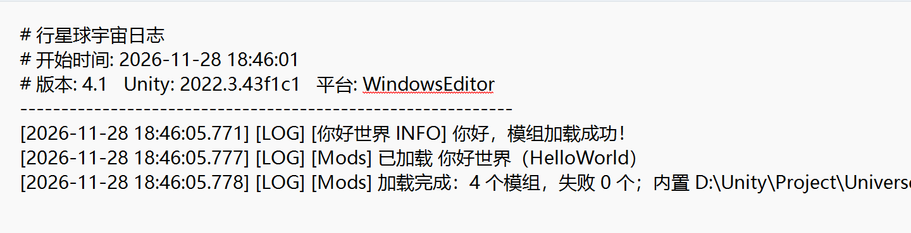

# 05 · 日志与出错排查

模组没反应是很常见的事，几乎都是下面几种原因之一。这一篇教你怎么**自己找到原因**。

## 先认识 logger（日志器）

`Startup` 拿到的 `instance` 里有一个 `logger`，可以在日志里打印信息：

| 写法 | 效果 | 日志里的标记 |
|---|---|---|
| `instance.logger.info("...")` | 普通信息 | `[你的模组名 INFO]` |
| `instance.logger.warn("...")` | 警告 | `[你的模组名 WARN]` |
| `instance.logger.err("...")` | 错误（会显示成红色） | `[你的模组名 ERR]` |
| `instance.logger.floatText("...")` | 屏幕左下角黄色浮字 | — |
| `instance.logger.floatText("...", Color.red)` | 指定颜色的浮字 | — |

建议在模组的关键步骤里打日志，比如：

```csharp
instance.logger.info("开始注册行星……");
// ...注册代码...
instance.logger.info("行星注册完成");
```

这样出问题时，看日志就知道走到哪一步了。

## 日志文件在哪

游戏根目录下的 `Logs` 文件夹：

```
Logs\
└─ log-20261128-183000.txt    ← 每次启动生成一个
```

打开**最新时间**的那个文件，用记事本的"查找"（Ctrl+F）搜你的模组文件夹名或显示名。

日志长这样（下面是 HelloWorld 示例加载成功时的记录）：



## 三种常见状态

### 情况 A：面板里根本看不到你的模组

说明游戏没把文件夹当成模组。检查：

1. 文件夹是不是直接放在 `Mods\` 下面（不是 `Mods\新建文件夹\HelloWorld`）；
2. 主文件是不是 `文件夹名.cs`，且真的在模组文件夹**根目录**；
3. 扩展名是不是变成了 `.cs.txt`；
4. 改完有没有重启游戏。

### 情况 B：面板显示"加载失败"，后面跟着一句话

点开面板能看到类似：

```
加载失败：CS1002: 应输入 ;
```

日志里会有更完整的：

```
[Mods] HelloWorld 编译失败:
Assets/.../HelloWorld.cs(5,42): error CS1002: 应输入 ;
```

读法：

- `(5,42)`：第 5 行、第 42 个字符附近有问题；
- `error CS1002`：错误编号（可以拿去搜）；
- 后面是说明。

常见错误对照：

| 错误 | 通常原因 | 怎么修 |
|---|---|---|
| `CS1002: 应输入 ;` | 某一行结尾少了分号 | 找到那一行，在末尾补 `;` |
| `CS1513: 应输入 }` | 大括号没配对 | 数一数 `{` 和 `}`，成对补上 |
| `CS0103: 当前上下文中不存在名称 xxx` | 名字拼错，或者忘了 `using` | 检查大小写；看教程里的拼写 |
| `CS0246: 未能找到类型 xxx` | 用了不存在的类，或没写 `using` | 检查拼写；需要时加 `using UnityEngine;` |
| `CS0117: 不包含 xxx 的定义` | 字段名写错 | 对照教程里的字段表 |
| `CS1061: 不包含 xxx 的定义` | 方法名写错 | 同上 |
| `CS1010: 常量中有换行符` | 字符串的引号没闭合 | 检查引号是否成对 |
| `CS1003: 语法错误, 应为 ','` | 括号/逗号/引号写错 | 从提示的行列往前后看 |

> 最常见的两个新手错误：**中文标点**（`；` `，` `“”`）和**漏写分号/大括号**。代码里除了字符串内部，一律用英文标点。

### 情况 C：面板显示"已加载"，但游戏里没效果

说明代码跑了，但功能没生效。检查：

1. 你写的功能是不是需要**进入沙盒/演化场景**才能看到（比如注册行星，只在沙盒的创建面板里出现）；
2. 开关是不是真的开了（面板显示"已加载"才算）；
3. 在 `Startup` 里加一行日志，确认它真的执行到了；
4. 看日志里有没有你写的 `[模组名 INFO]`。

## 红色浮字"有模组加载失败，请查看日志"

这是游戏在提醒你：至少有一个模组没编译成功。去日志里搜 `编译失败`，按上面的方法改。

## 游戏报错/卡死

如果某个模组运行时报错（比如事件里写错了），可能让游戏出现红色错误甚至卡住。处理办法：

1. 退出游戏；
2. 在模组管理面板里把可疑模组**关掉**；
3. 重启游戏，确认恢复正常；
4. 再打开你的模组，看日志定位问题。

## 排查顺序总结

```
看不到模组 → 看文件夹/主文件/扩展名/是否重启
加载失败   → 看日志里的 error CSxxxx，按行列找代码
已加载无效 → 加日志确认执行，确认场景对了
游戏报错   → 先关模组，再慢慢查
```

下一篇开始做真正能改变游戏内容的东西：[添加一颗行星](06-添加一颗行星.md)。

此文档由AI生成仅供参考，如有问题请在QQ群内提问
