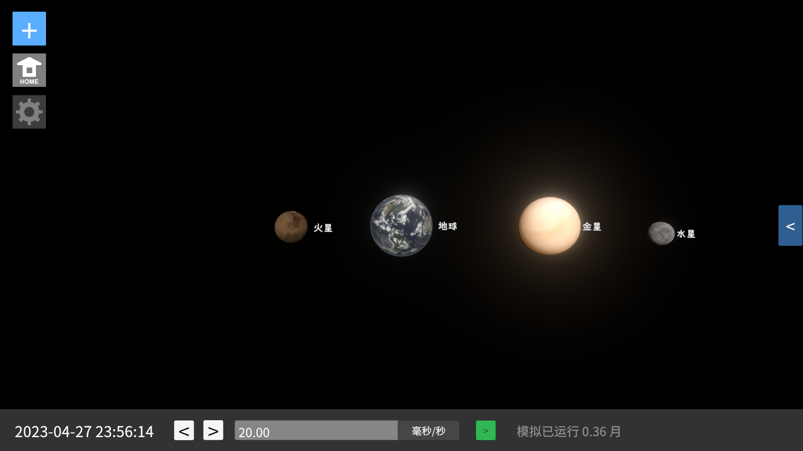

# 06 · 添加一颗行星

这一篇开始做真正改变游戏内容的东西：往沙盒的"创建行星"列表里加一颗自己的行星。

## 目标

进入沙盒 → 创建宇宙 → 打开行星/天体创建面板时，列表里多出一颗叫"蓝星"的行星，可以选中、放置、查看参数。



## 第 1 步：新建模组

在 `Mods` 里新建文件夹 `BluePlanet`，里面新建主文件 `BluePlanet.cs`。结构：

```
Mods\
└─ BluePlanet\
   ├─ BluePlanet.cs
   └─ desc.json
```

`desc.json`：

```json
{
    "name": "蓝星模组",
    "author": "你的名字",
    "version": "1.0",
    "description": "在沙盒里添加一颗蓝星。"
}
```

## 第 2 步：写代码

`BluePlanet.cs` 完整内容：

```csharp
using UnityEngine;

public class BluePlanet : UPBMod {
    public void Startup(UPBModInstance instance) {
        SandboxRegister.RegisterPlanet(new PlanetData {
            name = "蓝星",
            mass = 1.0,
            radius = 1.0,
            temperature = 288.0,
            rotationPeriodDays = 1.0,
            surface = new Resource("Textures/Planets/Earth_Surface"),
            atmosphere = new Resource("Textures/Planets/Earth_Atmosphere"),
            atmosphereShell = true,
        });

        instance.logger.info("已注册行星：蓝星");
    }
}
```

保存，打开模组开关，重启游戏。

## 第 3 步：确认效果

1. 主菜单 → 创建宇宙（进沙盒）；
2. 打开创建行星的界面，列表里应该能看到"蓝星"；
3. 选中它，看右侧参数面板（质量、半径、温度等）；
4. 放到场景里，应该是一颗带云层的地球风格星球。

## 这些参数是什么意思

`PlanetData` 里常用的字段：

| 字段 | 含义 | 单位/取值 | 例子 |
|---|---|---|---|
| `name` | 天体名字 | 文字 | `"蓝星"` |
| `mass` | 质量 | 地球质量 | `1.0` = 地球 |
| `radius` | 半径 | 地球半径 | `1.0` = 地球 |
| `temperature` | 表面温度 | 开尔文（K） | `288` ≈ 15°C |
| `rotationPeriodDays` | 自转周期 | 天 | `1.0` = 一天 |
| `rotationDirection` | 自转方向 | `1` 顺行，`-1` 逆行 | `1` |
| `axialTiltDeg` | 自转轴倾角 | 度 | `23.4` |
| `atmosphereMass` | 大气质量 | 地球大气质量 | `1.0` |
| `greenhouseFactor` | 温室效应强度 | 0 ~ 1 | `0.3` |
| `surface` | 地表贴图 | 资源引用 | `new Resource("Textures/Planets/Earth_Surface")` |
| `atmosphere` | 大气贴图 | 资源引用 | 同上 |
| `atmosphereShell` | 是否额外保留外圈光晕 | `true` / `false` | `true` |

> 温度用开尔文：0°C = 273.15K。想要"地球温度"就写 `288` 左右。

## 贴图先借用内置的

上面的例子里：

```csharp
surface = new Resource("Textures/Planets/Earth_Surface")
```

意思是"用游戏内置的地球地表贴图"。`Textures/...` 这些路径是游戏内部资源，第一次做先借用它，等第 07 篇再换成你自己的图片。

如果不想写大气层，可以把这两行删掉：

```csharp
atmosphere = ...,
atmosphereShell = true,
```

## 常见问题

- **列表里没有"蓝星"**：确认开关已开启、游戏已重启、日志里有 `已注册行星：蓝星`；
- **放上去是白球/黑球**：贴图路径写错了，检查 `Textures/Planets/...` 的大小写和拼写；
- **名字和内置行星重名**：不推荐，可能导致选择列表里不好区分，换个名字最省事。

## 小练习

复制一份代码，再注册一颗"红星"：

- `name = "红星"`；
- `temperature = 700`（更热）；
- `surface = new Resource("Textures/Planets/Mars")`（借用火星贴图）；
- 半径改成 `0.5`，质量改成 `0.1`。

重启后，列表里应该变成两颗你自己的行星。

下一篇：[使用自己的贴图](07-使用自己的贴图.md)。

此文档由AI生成仅供参考，如有问题请在QQ群内提问
