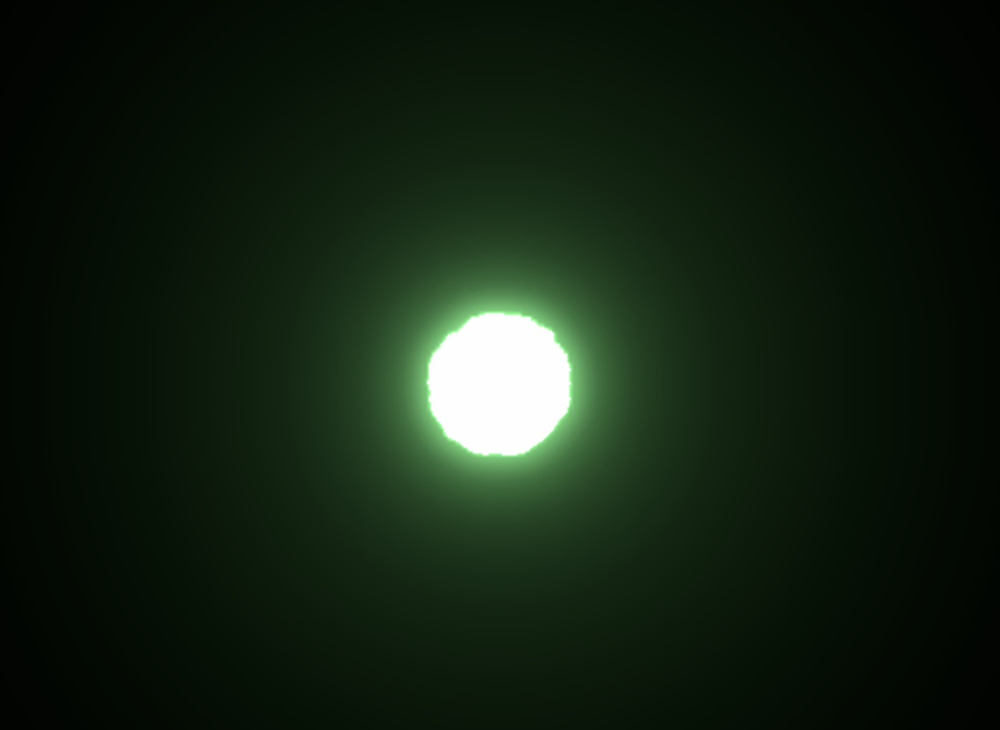

# 09 · 用事件改变游戏

前面几篇都是"加东西"，这一篇开始"改东西"：比如把所有恒星变成绿色、让恒星寿命翻倍、在演化每一步做点事。

## 事件是什么

游戏在某些时刻会"通知"模组：现在要算恒星颜色了、现在要算寿命了、演化走了一步……你把自己的函数挂到这些通知上，游戏就会调用你的函数。

事件分两种：

| 类型 | 写法 | 特点 |
|---|---|---|
| 单播事件 | `UPBEventBus.GetBlackbodyColorEvent = ...` | 一个位置只能有一个函数，后设置的覆盖先设置的 |
| 列表事件 | `UPBEventBus.AfterApplySSEPointEvent.Add(...)` | 所有模组的函数都会被执行一遍 |

事件是**全局**的：你设置的会作用于游戏里所有恒星/所有演化，不是只针对某一个。

## 例 1：把所有恒星变绿

```
Mods\
└─ GreenStars\
   ├─ GreenStars.cs
   └─ desc.json
```

```csharp
using UnityEngine;

public class GreenStars : UPBMod {
    public void Startup(UPBModInstance instance) {
        UPBEventBus.GetBlackbodyColorEvent = temperature => {
            return (0.4f, 1.0f, 0.4f);
        };
    }
}
```

`GetBlackbodyColorEvent` 要求返回三个 0~1 的小数：红、绿、蓝。上面就是"绿色"。

重启游戏，进恒星演化场景，恒星应该变成绿色：



## 例 2：在默认颜色上微调（提亮 + 偏蓝）

如果只是"稍微改一点"，可以先用游戏默认颜色：

```csharp
UPBEventBus.GetBlackbodyColorEvent = temperature => {
    var c = Spectrum.GetBlackbodyColor(temperature);   // 默认颜色
    return (c.r * 0.9f, c.g * 0.95f, c.b * 1.15f);     // 偏蓝一点
};
```

这里的 `Spectrum.GetBlackbodyColor(temperature)` 在事件函数里调用是安全的，它返回的是"如果没有模组干预，游戏原本会用的颜色"。

## 例 3：让恒星寿命翻倍

```csharp
UPBEventBus.GetLifespanEvent = args => {
    double original = StellarEvolutionEngine.GetLifespan(args.mass, args.metallicity);
    return original * 2.0;
};
```

- `args.mass`：质量（太阳质量）；
- `args.metallicity`：金属度；
- 返回值单位是 **Myr（百万年）**；
- 同样，事件函数里调用 `StellarEvolutionEngine.GetLifespan(...)` 拿到的是默认寿命，不会死循环。

重启后进恒星演化，同样参数的恒星，寿命应该变成原来的两倍。

## 例 4：监听演化每一步（列表事件）

列表事件用 `Add` 添加，游戏会依次调用所有模组的函数：

```csharp
public class StepLogger : UPBMod {
    public void Startup(UPBModInstance instance) {
        UPBEventBus.AfterApplySSEPointEvent.Add(args => {
            if (args.sseIndex % 50 == 0) {
                instance.logger.info("演化到第 " + args.sseIndex + " 步，年龄 " + args.point.time);
            }
        });
    }
}
```

- `args.point`：当前这一步的演化数据（年龄、光度等）；
- `args.sseIndex`：第几步；
- 这个事件**没有返回值**，只是通知。

> 不要每一步都打日志，会刷屏、也会拖慢游戏。上面的 `% 50 == 0` 表示每 50 步才打一次。

## 怎么取消事件

单播事件赋 `null` 就取消了：

```csharp
UPBEventBus.GetBlackbodyColorEvent = null;
```

列表事件在游戏里没有提供"删除"界面，一般不用管；实在需要，可以在 `Startup` 里不添加即可（重启游戏就清空了）。

## 注意事项

1. **单播事件后设置的生效**：如果你和另一个模组都改黑体颜色，只有后加载的那个有效；
2. **不要在事件里做耗时操作**：事件会被频繁调用（尤其是演化相关的事件），里面做复杂计算会卡；
3. **不要修改传进来的数据**：比如列表事件里的 `args.point`，只读就好；
4. **事件函数抛异常会影响游戏**：写事件时尽量简单，先在测试档里试；
5. 还有几个"拦截类"事件（`OnEvolveStepEvent`、`BeforeApplySSEPointEvent` 等）返回 `EventResult`，`EventResult.Skip` 会跳过/停止演化，属于进阶用法，不熟悉时不要随便用。

下一篇：[综合实战：我的星球包](10-综合实战-我的星球包.md)，把前面的东西拼成一个完整模组。

此文档由AI生成仅供参考，如有问题请在QQ群内提问
